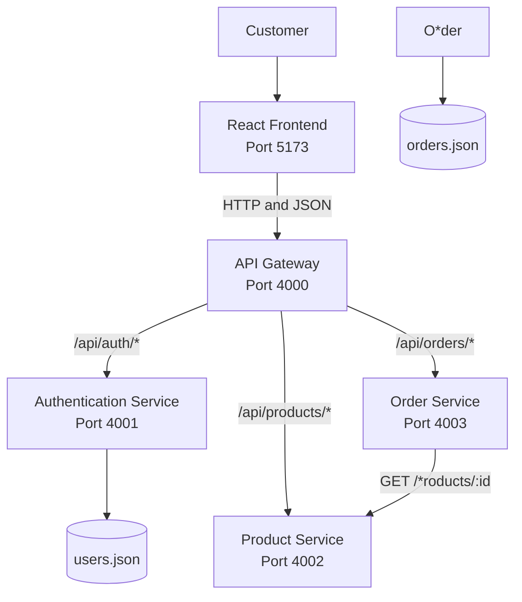

# NexaStore System Architecture

## 1. Introduction

NexaStore is an e-commerce prototype developed using Service-Oriented Architecture.

The application is divided into independent services responsible for:

- User authentication
- Product catalogue management
- Order processing
- Request routing

The services communicate through REST APIs using HTTP and JSON.

---

## 2. High-level architecture



The Reac* frontend communicates only with t*e API Gateway.

The API Gateway fo*wards requests to the correct inte*nal service.

---

## 3. System co*ponents

| Component | Port | Resp*nsibility |
|---|---:|---|
| React*Frontend | 5173 | User interface, *art, authentication forms and orde* history |
| API Gateway | 4000 | *ingle entry point and service requ*st routing |
| Authentication Serv*ce | 4001 | Registration, login, p*ssword hashing and JWT generation *
| Product Service | 4002 | Produc* catalogue, product prices and sto*k |
| Order Service | 4003 | Check*ut, product validation, total calc*lation and order history |

---

#* 4. API Gateway

The API Gateway p*ovides a single backend address fo* the frontend:

```text
http://localhost:4000/api
```

The gateway ro*tes requests as follows:

| Public*gateway path | Internal service |
*---|---|
| `/api/auth/*` | Authent*cation Service |
| `/api/products/*` | Product Service |
| `/api/orde*s/*` | Order Service |

For exampl*:

```text
Frontend request:
POST *api/auth/login

Gateway forwards t*:
POST http://localhost:4001/auth/login
```

The API Gateway is respo*sible for:

- Request routing
- Hi*ing internal service addresses
- C*RS configuration
- Request logging*- Returning controlled errors when*a service is unavailable

The API *ateway does not contain authentica*ion, product or order business log*c.

---

## 5. Authentication Serv*ce

The Authentication Service is *esponsible for customer identity.
*Its responsibilities include:

- R*gistering customers
- Validating i*put
- Preventing duplicate account*
- Hashing passwords with bcryptjs*- Validating login credentials
- C*eating JSON Web Tokens
- Returning*authenticated user information

Th* service stores users in:

```text*services/auth-service/data/users.j*on
```

Passwords are never saved *s plain text.

Example stored user*

```json
{
  "id": 1,
  "name": "*azaro Otieno",
  "email": "lazaro@*xample.com",
  "passwordHash": "$2*$10$...",
  "createdAt": "2026-11-*7T03:00:00.000Z"
}
```

---

## 6.*Product Service

The Product Servi*e owns product information.

Its r*sponsibilities include:

- Returni*g all products
- Returning one pro*uct
- Filtering products by catego*y
- Providing trusted prices
- Pro*iding available stock

Example pro*uct contract:

```json
{
  "id": 1*
  "name": "NexaPods Air",
  "cate*ory": "Audio",
  "description": "W*reless earbuds with clear calls an* deep bass.",
  "price": 2100,
  "*riginalPrice": 4000,
  "rating": 4*8,
  "reviewCount": 926,
  "stock"* 20,
  "badge": "BEST SELLER",
  "*mage": "/products/nexapods-air.jpg*
}
```

The Order Service obtains *roduct prices and stock through th* Product Service API.

The Order S*rvice does not directly access the*Product Service source code or int*rnal data.

---

## 7. Order Servi*e

The Order Service manages the c*eckout process.

Its responsibilit*es include:

- Verifying customer *WTs
- Receiving product IDs and qu*ntities
- Calling the Product Serv*ce
- Confirming product existence
* Validating quantities and stock
-*Obtaining trusted prices
- Calcula*ing order totals
- Creating orders*- Returning customer-specific orde*s

The Order Service stores orders*in:

```text
services/order-servic*/data/orders.json
```

Example sto*ed order:

```json
{
  "id": 1,
  *reference": "NEXA-00001",
  "userI*": 1,
  "customerEmail": "lazaro@e*ample.com",
  "items": [
    {
      "productId": 1,
      "name": "NexaPods Air",
      "unitPrice": 2100,
      "quantity": 2,
      "subtotal": 4200
    }
  ],
  "total": *200,
  "status": "CREATED",
  "cre*tedAt": "2026-11-17T03:30:00.000Z"*}
```

---

## 8. Authentication p*ocess

```mermaid
sequenceDiagram
*   actor Customer
    participant *I as React Frontend
    participan* GW as API Gateway
    participant*AS as Authentication Service
    p*rticipant Users as User Storage

 *  Customer->>UI: Enter email and p*ssword
    UI->>GW: POST /api/auth*login
    GW->>AS: POST /auth/logi*
    AS->>Users: Find user by emai*
    Users-->>AS: User and passwor* hash
    AS->>AS: Compare passwor* using bcrypt
    AS->>AS: Generat* JWT
    AS-->>GW: JWT and safe us*r data
    GW-->>UI: Login respons*
    UI->>UI: Save JWT in localSto*age
    UI-->>Customer: Display au*henticated account
```

The JWT pa*load contains:

```json
{
  "userI*": 1,
  "email": "lazaro@example.c*m"
}
```

Passwords are never stor*d inside the JWT.

---

## 9. Orde* creation process

```mermaid
sequ*nceDiagram
    actor Customer
    *articipant UI as React Frontend
  * participant GW as API Gateway
   *participant OS as Order Service
  * participant PS as Product Service*    participant Orders as Order St*rage

    Customer->>UI: Click Com*lete Checkout
    UI->>GW: POST /a*i/orders with JWT
    GW->>OS: POS* /orders
    OS->>OS: Verify JWT

*   loop For each cart item
       *OS->>PS: GET /products/:id
       *PS-->>OS: Product price and stock
*   end

    OS->>OS: Validate stoc*
    OS->>OS: Calculate trusted to*al
    OS->>Orders: Save order
   *Orders-->>OS: Stored order
    OS-*>>GW: 201 Created
    GW-->>UI: Or*er confirmation
    UI-->>Customer* Display My Orders
```

The fronte*d sends:

```json
{
  "items": [
    {
      "productId": 1,
      "quantity": 2
    }
  ]
}
```

The fr*ntend does not send a trusted price or user ID.

The user ID comes from the verified JWT, while prices come from the Product Service.

---

## 10. Service-Oriented Architecture principles

### 10.1 Loose coupling

Services communicate through API contracts instead of accessing each other’s internal source code or data.

For example, Order Service requests product data using:

```http
GET /products/:id
```

Order Service does not need to know how Product Service stores products.

### 10.2 Service autonomy

Each service:

- Runs as a separate process
- Has a separate port
- Has its own responsibility
- Controls its own logic
- Owns its data

### 10.3 Standardized service contracts

Services communicate using:

- HTTP
- REST endpoints
- JSON request bodies
- JSON responses
- Standard HTTP status codes

### 10.4 Reusability

The Authentication Service could be reused by:

- A mobile shopping application
- An administration portal
- A delivery application
- A customer support system

### 10.5 Interoperability

Clients developed using React, Java, Python, Kotlin or another technology can consume the services because communication uses HTTP and JSON.

### 10.6 Service composition

Creating an order combines several services:

1. Authentication Service establishes customer identity.
2. Product Service supplies trusted product information.
3. Order Service validates and creates the order.
4. API Gateway routes the requests.

### 10.7 Discoverability

The available endpoints, request bodies and responses are documented in:

```text
docs/API.md
```

---

## 11. Data ownership

Each service owns its business data.

| Data | Owning service |
|---|---|
| Customer accounts | Authentication Service |
| Password hashes | Authentication Service |
| Product information | Product Service |
| Product prices | Product Service |
| Product stock | Product Service |
| Orders | Order Service |
| Order items | Order Service |

A service must communicate with the owning service instead of directly accessing its storage.

---

## 12. Security design

The system applies the following security decisions:

- Passwords are hashed using bcryptjs.
- Plain passwords are never stored.
- JWTs expire after a configured period.
- Protected endpoints require an authorization header.
- Order Service verifies the JWT before creating an order.
- User identity comes from the verified JWT.
- Prices are obtained from Product Service.
- The frontend cannot choose the final product price.
- `.env` files are excluded from Git.
- Invalid and expired tokens return HTTP 401.
- Customers can retrieve only their own orders.

---

## 13. Failure handling

### Authentication Service unavailable

The API Gateway returns:

```http
503 Service Unavailable
```

```json
{
  "message": "Authentication Service is unavailable"
}
```

### Product Service unavailable during checkout

Order Service returns:

```http
503 Service Unavailable
```

```json
{
  "message": "Product Service is temporarily unavailable"
}
```

No order is created because its prices and stock cannot be verified.

### Invalid JWT

The protected service returns:

```http
401 Unauthorized
```

```json
{
  "message": "Invalid or expired authentication token"
}
```

### Product not found

Order Service returns:

```http
400 Bad Request
```

```json
{
  "message": "Product 999 was not found"
}
```

### Insufficient stock

Order Service returns:

```http
409 Conflict
```

```json
{
  "message": "Only 2 unit(s) of NexaPods Air are available"
}
```

---

## 14. Design limitations

The current implementation is a classroom prototype.

Known limitations include:

- JSON file storage
- No real payment service
- No M-Pesa integration
- No email verification
- No password recovery
- No administrator portal
- No distributed transactions
- No message broker
- No automated deployment
- No production monitoring
- No automated test suite

JSON files are not appropriate for production because concurrent write operations can overwrite data.

---

## 15. Future architecture improvements

A production version could add:

- PostgreSQL databases owned by individual services
- M-Pesa Daraja API integration
- Payment Service
- Notification Service
- Inventory reservation
- RabbitMQ or Apache Kafka
- Saga pattern for distributed transactions
- OpenAPI and Swagger documentation
- Docker Compose
- Kubernetes deployment
- Centralized logging
- Rate limiting
- Automated unit and integration tests
- Asymmetric JWT signing